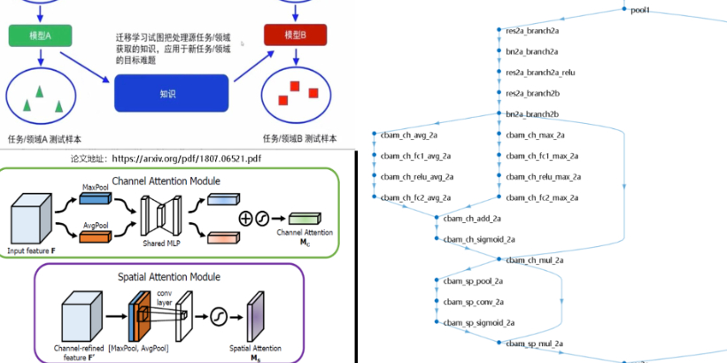

# Integration of CWT-CBAM-Resnet18 for bearing fault diagnosis, MATLAB code, using XiuYu University bearing data as an example

This issue realizes feature extraction based on Continuous Wavelet Transform (CWT) and constructs a Resnet18 network with the integration of CWT-CBAM attention mechanism for bearing fault diagnosis under different working conditions.
For more details, please visit:
Fusion of CWT-CBAM-Resnet18 Bearing Fault Diagnosis, including MATLAB code.

## Images

<!-- PAYMENT_BLOCK -->

## Get this dataset

- Payment link (Stripe): [Buy now](https://buy.stripe.com/3cs8yP7sY87d0vu9AB)
- Payment QR code: 

<!-- /PAYMENT_BLOCK -->
